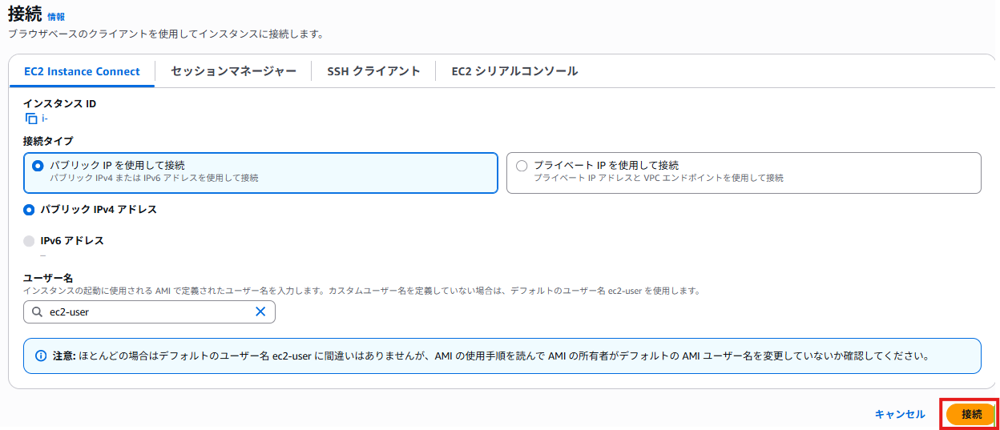
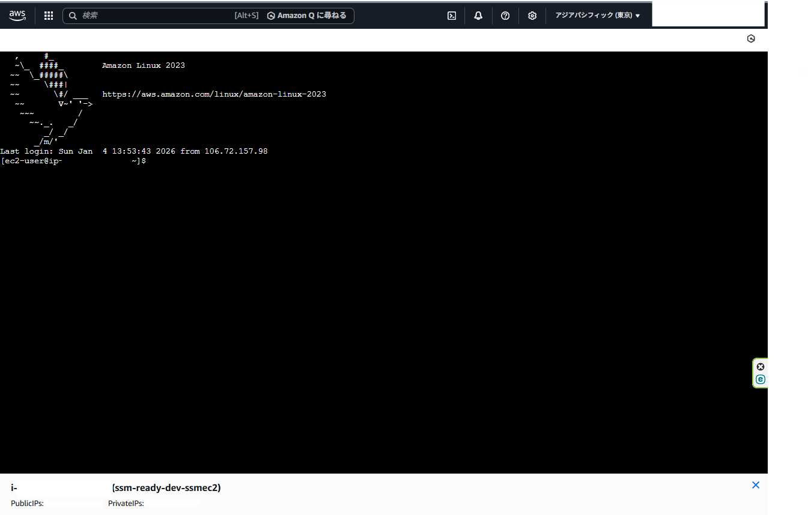
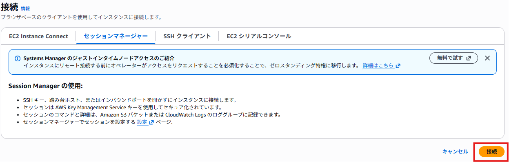
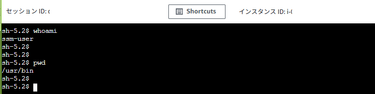
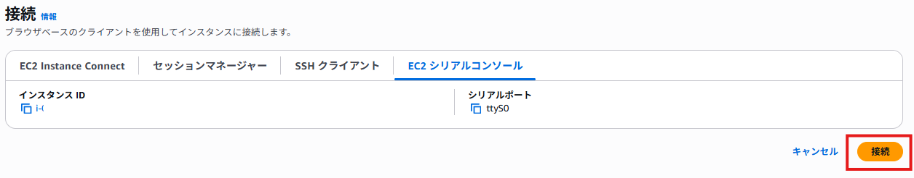
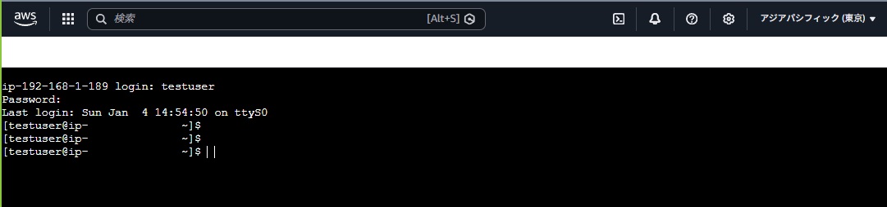

# EC2接続方式検証

## 検証の背景

VMware環境では、VMware Toolsやリモートコンソールなど、仮想マシンを操作・管理するための仕組みを利用してきた。一方、EC2ではどのような仕組みで接続し、それぞれにどのような前提条件があるのか改めて整理しておきたいと考えた。

そこで、SSH、EC2 Instance Connect、Session Manager、EC2シリアルコンソールの4つの接続方式を実際に試し、接続の仕組みと必要な設定を確認した。本記事では、その結果をもとに、通常のログインと障害対応で利用する接続方法を整理する。


## 接続方法1: SSHでのログイン

一般的なSSHによる接続。インスタンスへのネットワーク到達性と、セキュリティグループなどでSSH通信（通常はTCP 22番）を許可する設定が必要になる。今回は秘密鍵を指定して接続する。

```bash
ssh -i <秘密鍵> ec2-user@<IPアドレス>
```


## 接続方法2: EC2 Instance Connect（鍵レス SSH）


SSH（TCP 22番）を使う点は通常のSSH接続と同じだが、ブラウザから接続する場合は、ローカルに秘密鍵ファイルを用意する必要がない。

接続時には、EC2 Instance Connect APIを通じて一時的なSSH公開鍵を登録し、その鍵を使ってユーザー認証を行う。利用には、インスタンスにEC2 Instance Connectに対応するソフトウェアが導入されていることなどの前提条件があるが、秘密鍵ファイルの管理の手間を減らせる。



<BR>

接続すると以下のような画面となる  


## 接続方法3:セッションマネジャー（SSH不要）

AWS Systems ManagerのSession Managerを使って接続する方式。SSHを使用しないため、インスタンスへのインバウンド通信（TCP 22番）の許可は不要で、接続権限はIAMで制御できる。  
ただし、インスタンスからSSMへのアウトバウンド通信（HTTPS／TCP 443番）は必要となる。SSMに接続できるよう、インターネット経由またはVPCエンドポイント経由の通信経路を用意する。  
今回は、セキュリティグループのインバウンドルールをすべて削除し、アウトバウンド通信を許可した状態で接続できることを確認した。


以下で接続する。  


接続すると以下のような画面となる。接続ユーザはssm-user。  


## 接続方法4:**EC2 シリアルコンソール**

SSHでもSSM（Session Manager）でもサーバにログインできないときに使用するのがシリアルコンソールである。ただし、これを使うためには以下の要件を満たす必要がある。

- アカウント（リージョン）でシリアルコンソールを有効化
- ユーザー/ロールに **EC2 Serial Console に接続するための権限**が必要。ここではAdministartorAccess権限を持ったユーザで実行のため省略
    - [https://docs.aws.amazon.com/ja_jp/AWSEC2/latest/UserGuide/configure-access-to-serial-console.html#set-user-password](https://docs.aws.amazon.com/ja_jp/AWSEC2/latest/UserGuide/configure-access-to-serial-console.html#set-user-password)
- パスワードでログインするユーザを用意する必要がある。サンプルでtestuserというユーザを作成

※詳細は以下参照。  
参考：[https://docs.aws.amazon.com/ja_jp/AWSEC2/latest/UserGuide/ec2-serial-console-prerequisites.html](https://docs.aws.amazon.com/ja_jp/AWSEC2/latest/UserGuide/ec2-serial-console-prerequisites.html)

```bash
# アカウント（リージョン）でシリアルコンソールを有効化
## 状態確認
aws ec2 get-serial-console-access-status --region ap-northeast-1

## 有効化
aws ec2 enable-serial-console-access --region ap-northeast-1

## (無効化）
aws ec2 disable-serial-console-access --region ap-northeast-1

```

<br>

ログイン画面は以下となる  


接続後Enterキーを入力するとプロンプトが現れる。  


## まとめ

- **SSH**：秘密鍵を使って接続する基本的な方法。
- **EC2 Instance Connect**：SSH接続時の鍵管理の手間を減らせる。
- **Session Manager**：22番ポートの許可は不要だが、SSMへのアウトバウンド通信は必要。
- **EC2シリアルコンソール**：起動やネットワークの問題を調査するための接続手段。事前に設定と接続確認をしておく。