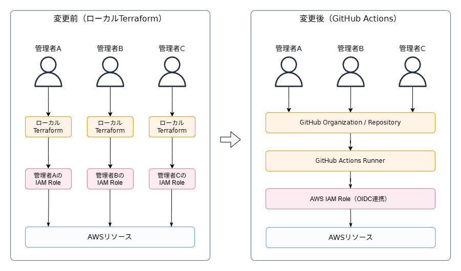
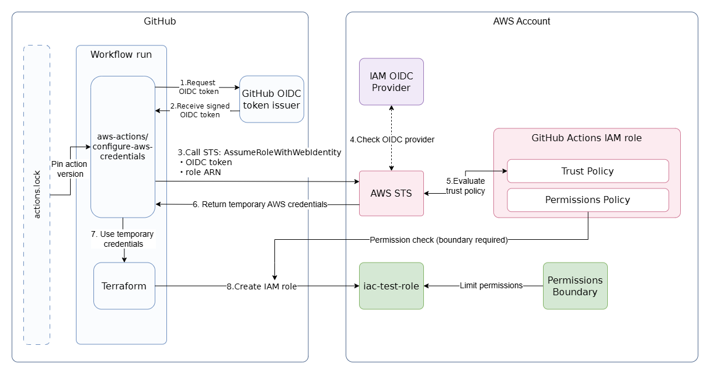
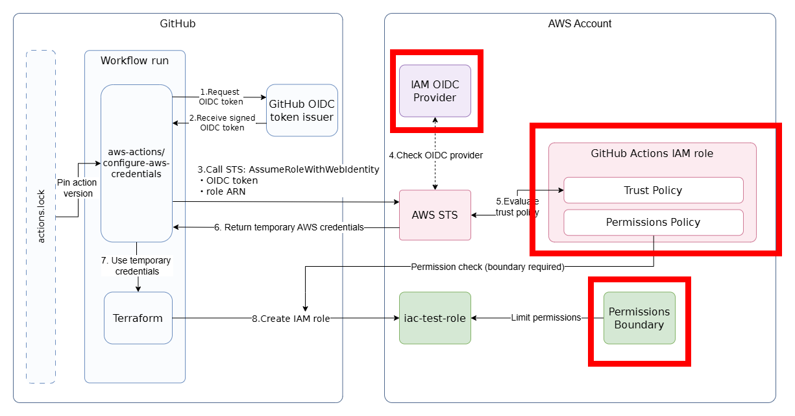
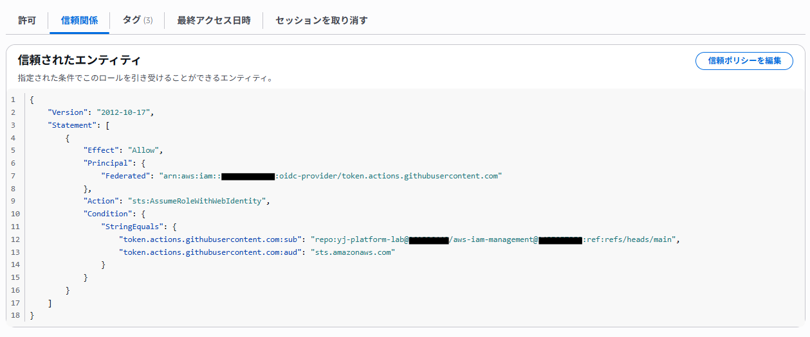
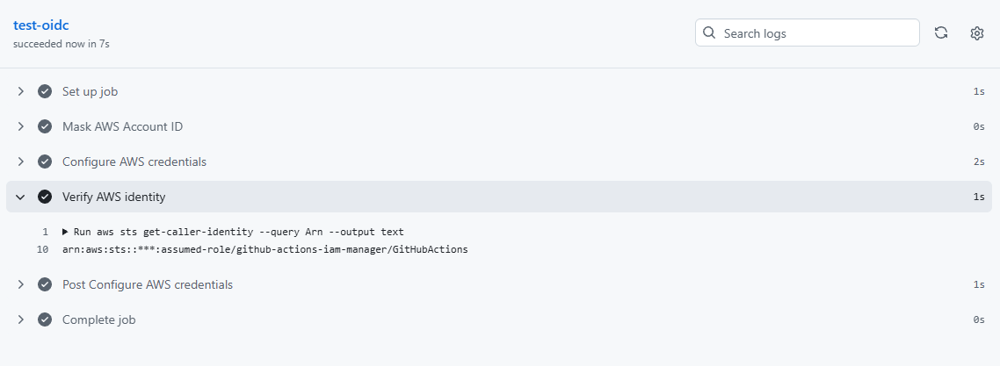
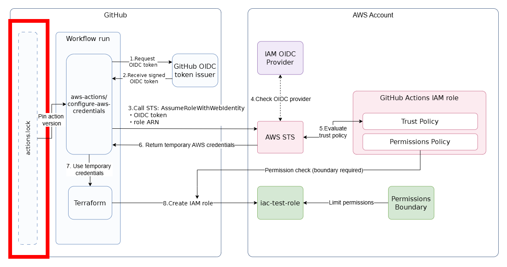
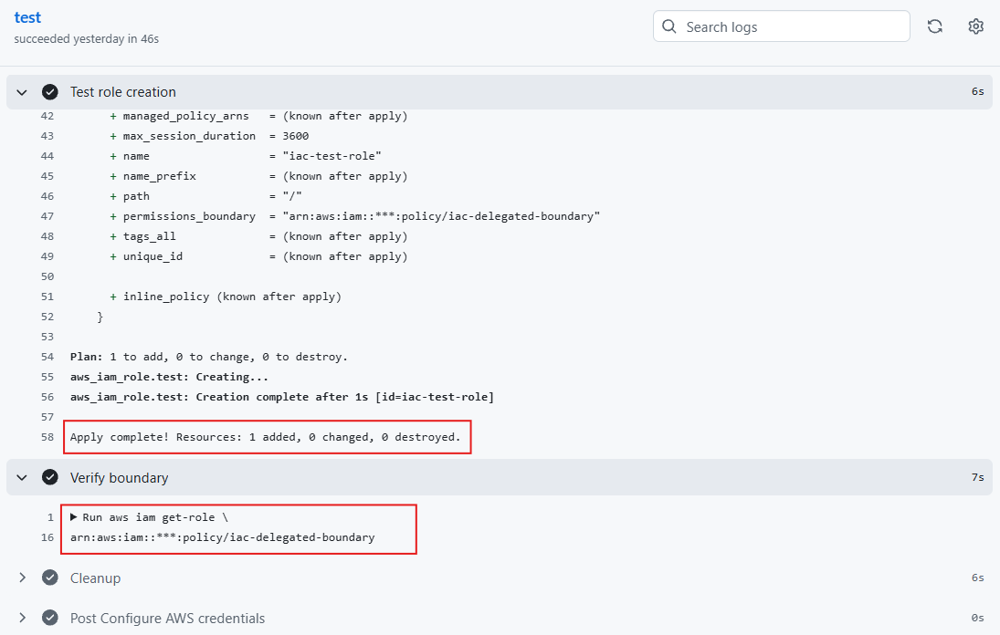
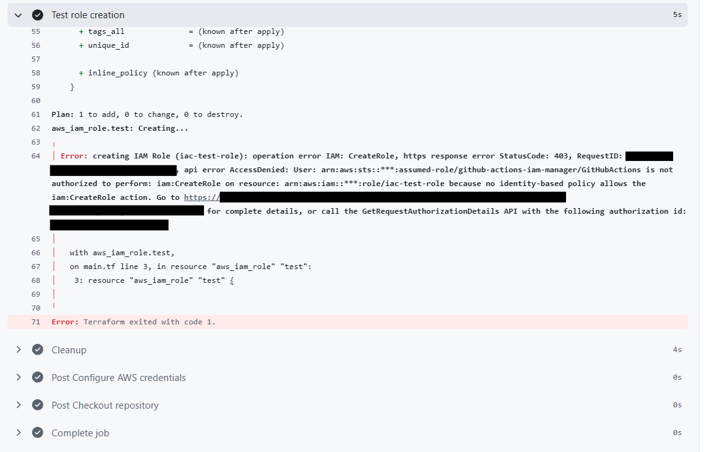
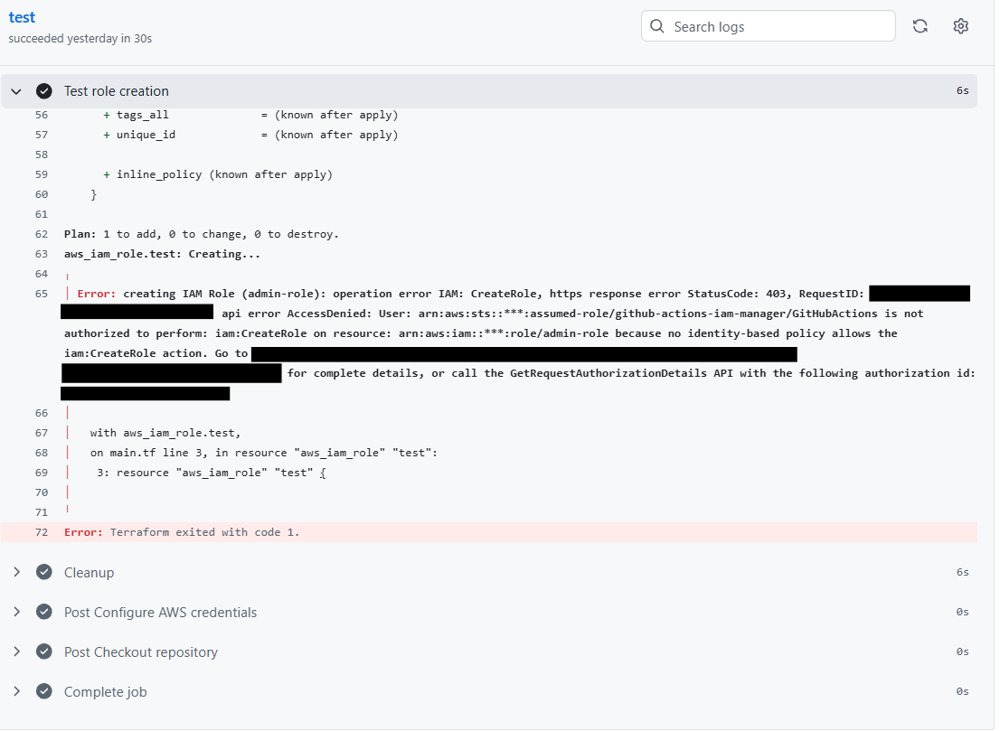

# GitHub ActionsによるIAM管理基盤の構築

## 検証の背景

GitHub ActionsとTerraformを使用して、Amazon ECS Fargate上にSplunkの検証環境を構築する際、IAMロールの管理方法が課題となった。

当初は管理者ごとにAWSの認証情報を用意し、ローカルからTerraformを実行する方針だった。しかし、管理者が増えるたびにAWS側で権限を設定する必要があり、運用に手間がかかる。

そこで、Terraformの実行をGitHub Actionsに集約し、OIDC認証で引き受けたIAMロールを通じてAWSリソースを操作する構成に変更した。これにより、管理者ごとのAWS認証情報が不要となり、実行環境と権限を統一できる。

本検証では、初回のBootstrapを除くIAMロール管理をGitHub ActionsとTerraformで自動化する。変更前後の構成を以下に示す。



### 認証の仕組み

構築に先立ち、GitHub ActionsとAWS間のOIDC認証の仕組みを説明する。

Workflow実行時、aws-actions/configure-aws-credentials がGitHubからOIDCトークンを取得し、AssumeRoleWithWebIdentity を使用してAWS STSにIAMロールの引き受けを要求する。STSはトークンとIAM OIDC Provider、Trust Policyの設定を検証し、条件を満たせば一時認証情報を発行する。GitHub Actionsはこの認証情報を使用してTerraformを実行する。



### 初期構築の方針

初期構築では、GitHub Actionsの実行に必要なIAMリソースのみ手動で作成し、ManagedBy = Manual タグを付与する。それ以外はTerraformで管理する。以下に構成を示す。赤枠部分が手動作成するリソースである。



IAMロールの権限管理には、AWSが推奨する最小権限の原則に基づき、Permissions Boundaryを採用して権限の上限を制限する。  
参考：[AWS公式：IAM Permissions Boundaries](https://aws.amazon.com/blogs/security/delegate-permission-management-to-developers-using-iam-permissions-boundaries/)

### 初期構築用IAMリソースの作成

GitHub ActionsからTerraformでIAMリソースを管理するため、AWSコンソールで以下の4つを作成する。

| リソース | 役割・主な設定 |
| --- | --- |
| **GitHub OIDC Provider** | GitHub ActionsからAWSへのOIDC認証に使用する。<br>Provider URL：[https://token.actions.githubusercontent.com](https://token.actions.githubusercontent.com/)<br>Audience：[sts.amazonaws.com](http://sts.amazonaws.com/) |
| **github-actions-iam-manager** | TerraformでIAMを管理するためのロール。Trust PolicyでOIDCのaudとsubを制限する。 |
| **github-actions-iam-manager-policy** | IAM管理用ロールのPermissions Policy。iac-* のロール・ポリシー管理を許可し、Boundaryの指定を必須とする。 |
| **iac-delegated-boundary** | Terraformで作成するIAMロールの権限上限を定義する。 |

<br>

github-actions-iam-managerのTrust Policy  


Permissions Policyでは、IAMリソースの参照を許可し、ロール・ポリシーの作成・管理対象を iac-* に限定する。また、**ロール作成時にはPermissions Boundaryの指定を必須**とし、Boundary自体の変更を禁止する。  
作成したロールに AdministratorAccess を付与しても、Boundaryで許可されていない操作は原則として実行できない。

### GitHub Actionsからの認証確認

GitHub ActionsからIAMロールを引き受けられることを確認するため、test-oidc.ymlを作成した。  
aws-actions/configure-aws-credentials でOIDC認証を行い、aws sts get-caller-identity で github-actions-iam-manager を正常に引き受けられることを確認した。



### GitHub Actionsの依存関係を固定

GitHub Actionsでは、Actionをバージョンタグで指定しても、参照先のコミットが変更される可能性がある。そこで、2026年10月28日に正式提供された actions.lock を導入し、使用するActionのコミットSHAを固定する。



<br>

ロックファイルの生成には、GitHub CLIと拡張機能を使用する。

```
# 拡張機能のインストール（初回のみ）
gh extension install github/gh-actions-lock

# ロックファイルの生成・更新
gh actions-lock

# 整合性の確認
gh actions-lock --verify
```

生成された .github/workflows/actions.lock は、WorkflowとともにGitで管理する。

### TerraformによるIAMロールの作成・検証

GitHub ActionsからTerraformを実行し、IAMロールの作成条件を以下の3パターンで検証した。

| Workflow | ロール名 | Boundary | 実行結果 |
| --- | --- | --- | --- |
| test-iam-role-01.yml | iac-test-role | あり | 成功 |
| test-iam-role-02.yml | iac-test-role | なし | 拒否（AccessDenied） |
| test-iam-role-03.yml | admin-role | あり | 拒否（AccessDenied） |

<br>

**実行ログ**

テスト01：ロールの作成とBoundaryの設定を確認  


テスト02：Boundary未指定による作成拒否を確認  


テスト03：ロール名の制限による作成拒否を確認  


以上より、iac-* ロールの作成には指定したPermissions Boundaryが必要であり、条件を満たさない場合は作成が拒否されることを確認した。

## まとめ

本検証では、GitHub ActionsとTerraformを使用して、IAMロールの作成・管理を自動化する仕組みを構築した。OIDC認証とPermissions Boundaryを組み合わせることで、管理者ごとのAWS認証情報を不要とし、IAMロールの作成条件を制限できることを確認した。今後は、この仕組みを利用してECS Fargateの検証環境を構築していく。