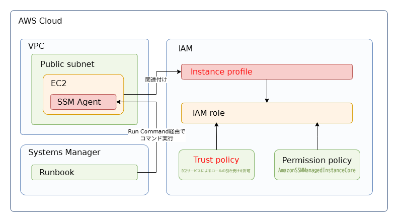

# EC2をSystems Managerで管理するための前提条件

## 背景
Systems Manager AutomationのRunbookを使った検証のため、EC2をSystems Managerの管理対象にする必要があった。

SSM AgentがインストールされていればRunbookは利用できると考えていたが、[前回の記事](https://github.com/yj-platform-lab/tech-verification/blob/main/vbox-to-ec2-migration/README.md)で作成したRHEL 7にSSM AgentをインストールしてもSystems Managerの管理対象として認識されなかった。そこで、必要なIAMロールや通信要件を整理し、Terraformで設定・検証する。

## 結論
今回の構成では、EC2をSystems Managerの管理対象にするために、以下の設定が必要だった。

 - SSM Agentをインストールし、起動する。  
 - AmazonSSMManagedInstanceCoreを付与したIAMロールを、インスタンスプロファイル経由でEC2に関連付ける。  
 - SSMエンドポイントへのアウトバウンド通信を可能にする。

これらの条件を満たすことで、Systems Manager AutomationのRunbookを正常に実行できることを確認した。


## 手順

### Step0:環境構築

Terraformで検証環境を構築する。使用した設定は、main-sample.tfを参照（環境固有の情報はマスク済み）。  
AMI IDは公式が提供しているIDを使用している。


### Step1:SSMに認識されていないことを確認

まずは以下のコマンドで当該インスタンスの情報が表示されないことを確認する。  
インスタンスの情報が表示されるようであれば今回の作業はそもそも不要である。

```bash
aws ssm describe-instance-information
```

### Step2:EC2にSSM Agentが存在することを確認

対象のEC2にSSMがインストールされているか確認する。コマンドの詳細は以下を参照。  
参考：[https://docs.aws.amazon.com/ja_jp/systems-manager/latest/userguide/agent-install-rhel-7.html](https://docs.aws.amazon.com/ja_jp/systems-manager/latest/userguide/agent-install-rhel-7.html)

```bash
#SSM導入確認
systemctl status amazon-ssm-agent

#自動起動設定（enabledであることを確認）
systemctl is-enabled amazon-ssm-agent

#（上記が入っていない場合）SSM導入
sudo yum install -y https://s3.amazonaws.com/ec2-downloads-windows/SSMAgent/latest/linux_amd64/amazon-ssm-agent.rpm
```

### Step3:EC2にIAMロールが付与されているか確認

以下のコマンドを実行し、対象のEC2インスタンスにAmazonSSMManagedInstanceCoreポリシーを持つIAMロールが付与されているかを確認する。  
参考:[https://docs.aws.amazon.com/ja_jp/systems-manager/latest/userguide/setup-instance-permissions.html](https://docs.aws.amazon.com/ja_jp/systems-manager/latest/userguide/setup-instance-permissions.html)

```bash
aws ec2 describe-instances \
  --instance-ids i-xxxxxxxxxxxxxxxxx \
  --query "Reservations[].Instances[].IamInstanceProfile"
```

<br>

今回構築したEC2にはIAMロールを設定していないため、IAMロールと関連リソースを作成する。ここで押さえておきたいポイントは、以下の3点である。

- **Trust Policy（信頼ポリシー）**  
  IAMロールの作成時に必須であり、「誰がそのロールを引き受けられるか」を定義する。今回は、EC2サービスによるロールの引き受けを許可する。

- **Permissions Policy（権限ポリシー）**  
  「そのロールで何ができるか」を定義する。権限ポリシーなしでもロールは作成できるが、今回必要なSSMの操作権限は付与されない。そのため、AWS管理ポリシーの`AmazonSSMManagedInstanceCore`をアタッチする。

- **インスタンスプロファイル**  
   AWSの仕様上、IAMロールをEC2に直接関連付けることはできず、インスタンスプロファイルを介して関連付ける必要がある。

<br>

図示すると以下のようになる  



以下に、IAMロール、ポリシーのアタッチ、およびインスタンスプロファイルを作成する Terraform設定ファイルを示す。

```hcl
# ---------------------------------------
# IAM Role (Required) trust_poricy
# ---------------------------------------
data "aws_iam_policy_document" "ec2_trust" {
  statement {
    effect = "Allow"

    principals {
      type        = "Service"
      identifiers = ["ec2.amazonaws.com"]
    }

    actions = ["sts:AssumeRole"]
  }
}

resource "aws_iam_role" "ec2_ssm_role" {
  name               = "ec2_ssm_role"
  assume_role_policy = data.aws_iam_policy_document.ec2_trust.json
}

# ---------------------------------------
# Attach the AmazonSSMManagedInstanceCore to Role
# ---------------------------------------
resource "aws_iam_role_policy_attachment" "ssm" {
  role       = aws_iam_role.ec2_ssm_role.id
  policy_arn = "arn:aws:iam::aws:policy/AmazonSSMManagedInstanceCore"
}

# ---------------------------------------
# Create Instance Profile
# ---------------------------------------
resource "aws_iam_instance_profile" "ssm_ec2_profile" {
  name = aws_iam_role.ec2_ssm_role.name
  role = aws_iam_role.ec2_ssm_role.name
}

```

<br>
インスタンスプロファイル作成後、EC2 リソース側にもその設定を追記する必要がある。  
以下のiam_instance_profile行が追記箇所である。

```hcl
# ---------------------------------------
# EC2 Instance
# ---------------------------------------
resource "aws_instance" "ssmec2" {
  ami                         = "ami-09cd9fdbf26acc6b4"
  instance_type               = "t3.micro"
  subnet_id                   = aws_subnet.public_subnet_1a.id
  associate_public_ip_address = true
  iam_instance_profile        = aws_iam_instance_profile.ssm_ec2_profile.name
  vpc_security_group_ids = [aws_security_group.ssh_sg.id]
  key_name               = aws_key_pair.ssh.key_name

  tags = {
    Name    = "${var.project}-${var.environment}-ssmec2"
    Project = var.project
    Env     = var.environment
  }
}

```

<br>

terraform applyが終わったら、再度以下のコマンドでInstanceProfileが設定されているか確認する。  
今度は上記で設定したInstanceProfileの設定が現れるはずである。

```bash
aws ec2 describe-instances \
  --instance-ids i-xxxxxxxxxxxxxxxxx \
  --query "Reservations[].Instances[].IamInstanceProfile"
```

### Step4:SSM へのアウトバウンド通信を確認

SSM Agentは、以下のAWSマネージドエンドポイントに対してアウトバウンド通信を行う。

- ssm.<region>.amazonaws.com
- ec2messages.<region>.amazonaws.com
- ssmmessages.<region>.amazonaws.com

参考  
[https://docs.aws.amazon.com/ja_jp/systems-manager/latest/userguide/setup-create-vpc.html](https://docs.aws.amazon.com/ja_jp/systems-manager/latest/userguide/setup-create-vpc.html)  
[https://docs.aws.amazon.com/ja_jp/prescriptive-guidance/latest/patterns/connect-to-an-amazon-ec2-instance-by-using-session-manager.html](https://docs.aws.amazon.com/ja_jp/prescriptive-guidance/latest/patterns/connect-to-an-amazon-ec2-instance-by-using-session-manager.html)

そのため、EC2がプライベートサブネットに配置されている場合は、上記エンドポイントに対応する VPC エンドポイントを作成する必要がある。  
一方、今回のEC2はInternet Gatewayに接続されたVPC上に配置されているため、VPCエンドポイントの作成は不要である。  
ただし、**EC2 が0.0.0.0/0宛にアウトバウンド通信できること**は前提条件となる。そのため、当該インスタンスにアタッチされているセキュリティグループのアウトバウンドルールを以下のコマンドで確認する。

```bash
aws ec2 describe-security-groups \
  --group-ids sg-xxxxxxxx \
  --query "SecurityGroups[].IpPermissionsEgress"
```

<br>

この結果に0.0.0.0/0が含まれていれば問題ない。しかしTerraformで設定を行った場合、これらのアウトバンドルールは別途設定する必要がある。そのためstep0で記載した# Security Groupセクションに以下の内容を追記する。

```hcl
resource "aws_security_group_rule" "allow_all_egress" {
  security_group_id = aws_security_group.ssh_sg.id
  type              = "egress"
  protocol          = "-1"
  from_port         = 0
  to_port           = 0
  cidr_blocks       = ["0.0.0.0/0"]
}
```

<br>

再度以下を実行して、アウトバンドのルールが表示されたらStep4は完了。

```bash
aws ec2 describe-security-groups \
  --group-ids sg-xxxxxxxx \
  --query "SecurityGroups[].IpPermissionsEgress"
```

### Step5:SSMに認識されていることを確認

Step1で実行したコマンドを入力し、インスタンスの情報が表示されることを確認する。

```bash
##SSM登録状況確認
aws ssm describe-instance-information

##実行結果
{                                                                  
    "InstanceInformationList": [                                   
        {                                                          
            "InstanceId": "i-XXXXXXXXXXXXXXXX",                   
            "PingStatus": "Online",                                
            "LastPingDateTime": 1767181118.27,                     
            "AgentVersion": "3.3.3572.0",                          
            "IsLatestVersion": false,                              
            "PlatformType": "Linux",                               
            "PlatformName": "Red Hat Enterprise Linux Server",     
            "PlatformVersion": "7.2",                              
            "ResourceType": "EC2Instance",                         
            "IPAddress": "XXX.XXX.XXX.XXX",                          
            "ComputerName": "rheltest",                            
            "SourceId": "i-XXXXXXXXXXXXXXXXX",                     
            "SourceType": "AWS::EC2::Instance"                     
        }                                                          
    ]                                                              
}                                                                  
```

以上でSystems Managerへの登録は完了。Managed Instanceとして認識されていることが確認できる。
