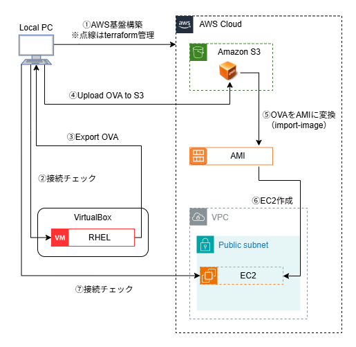
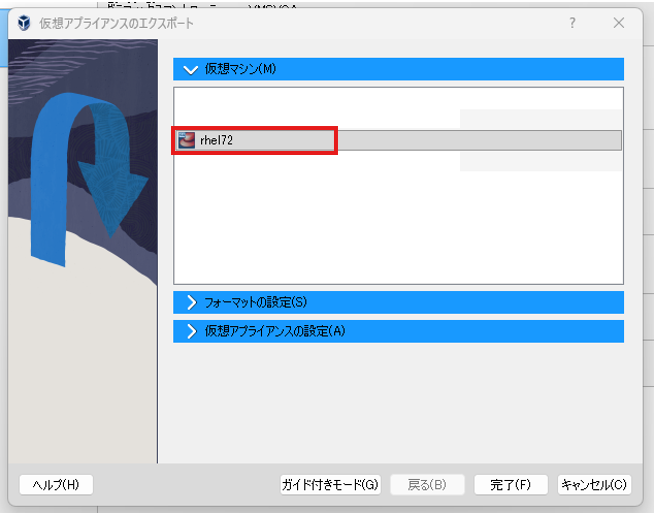
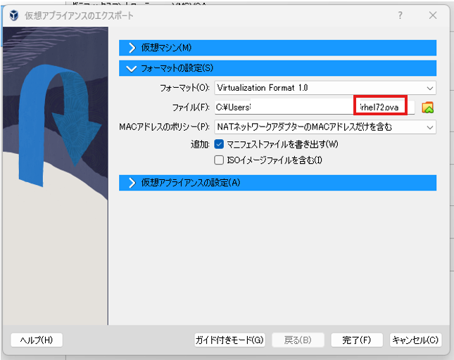

# VirtualBox仮想マシンをEC2に移行する

## 検証の背景
業務で使用しているEC2（RHEL 7）はXen世代のインスタンスであり、コスト削減に向けてインスタンスタイプの変更を検討している。

しかし、検証時点ではAWS上でRHEL 7のAMIが提供されていなかった。そこで、VirtualBox上にRHEL 7環境を構築し、VM Import/ExportでAMI化することで、EC2上に検証環境を再現できるか確認する。


## 検証結果

- VirtualBox上の仮想マシンは、AWS VM Import/Exportを利用することでAMI化し、EC2上で起動およびSSH接続まで再現可能。
- ImportしたAMIはTerraform管理外となるため、Terraformではdata sourceとして参照する運用が現実的。


## 全体の流れ

VirtualBoxからExportしたRHEL 7（OVAファイル）をS3にアップロードし、import-imageでAMI化する。その後AMIからEC2を起動し、AWS環境にRHEL 7を構築する。  



## 手順

### Step 1. Terraform で基盤を作る

Terraformで以下のリソースをまとめて構築する。
- S3バケット（VM Import用）
- VPC
- Subnet（Public）
- Internet Gateway
- Route Table + Association
- Security Group
- IAMロール（VM Import用）
> 
> **なぜIAMロールが必要なのか**
>
> `aws ec2 import-image`によるAMI変換は、AWSのVM Import/Exportサービスが実行する。このサービスにS3上のOVAを読み取る権限などを付与するため、事前にIAMロールを作成する必要がある。  
(参考）[https://docs.aws.amazon.com/ja_jp/vm-import/latest/userguide/required-permissions.html](https://docs.aws.amazon.com/ja_jp/vm-import/latest/userguide/required-permissions.html)


基盤構築に使用したTerraform設定は、main-sample.tfに記載した（固有情報はマスク済み）


### Step 2. SSH鍵を作成・登録し、ローカルからVMへの接続を確認

EC2に移行した後も同じ鍵でログインできるようローカル環境でSSH鍵を作成し、VirtualBox VMに取り込んで接続確認をする。以下のコマンドでSSH鍵を生成。  
```bash
ssh-keygen -t ed25519 -f <鍵の名前>
```

<br>

上記で作成される公開鍵をVirtualBox上の仮想マシンに登録。  
```bash
#公開鍵をVM側へ登録（VM内で実行）
mkdir -p ~/.ssh
cat <公開鍵> >> /home/<ユーザ名>/.ssh/authorized_keys
chown -R <ユーザ名>:<ユーザ名> /home/<ユーザ名>/.ssh
chmod 700 /home/<ユーザ名>/.ssh
chmod 600 /home/<ユーザ名>/.ssh/authorized_keys
```

<br>

ローカルPCから鍵を指定してSSH接続できるか確認。
```bash
#パスワードを聞かれずにログインできること
ssh -i <秘密鍵> <ユーザ名>@<ipアドレス>
```


### Step 3. VirtualBox VMを停止し、OVAエクスポート

Step2が完了後VirtualBox上の仮想マシンをシャットダウンする。  
その後「ファイル」→「仮想アプライアンスのエクスポート」を選択し、対象の仮想マシンを選択


<br>

フォーマットの設定はovaファイルとする。[完了]を選択し、ovaファイルをエクスポート。


指定したフォルダにovaファイルが生成されていることを確認する。


### Step 4. OVAアップロード

Step1で作成したS3バケットにStep3で取得した`rhel72.ova` をアップロードする。
```bash
#S3バケット一覧を表示
aws s3 ls

#フェーズ1で作成したs3にアップロード
aws s3 cp rhel72.ova s3://<フェーズ1で作成したs3>

#ovaファイルがアップロードされていることを確認
aws s3 ls <フェーズ1で作成したs3>
```

### Step 5. `import-image` でAMI作成 → 完了まで状態確認 → ImageId を把握

Step4でS3に取り込んだOVAをAMIに変換する。
```bash
#S3に置いたovaをAMIに変換
aws ec2 import-image \
    --description "$(date '+%b %d %H:%M') RHEL7.2" \
    --disk-containers '[{
    "Format": "OVA",
    "UserBucket": {
      "S3Bucket": "<Step1で作成したs3バケット名>",
      "S3Key": "rhel72.ova"
    }
  }]' 

#状態確認（"Status"が"completed"になるまで待つ。今回の検証では15分くらいかかった）
aws ec2 describe-import-image-tasks

#StatusがCompletedになったらImageIDを取得
aws ec2 describe-images --owner self
```

### Step 6. AMI情報を確認し、Terraformのdata sourceで参照できるようにする

Step5でVM Importにより作成したAMIはAWS CLIで作成されているため、Terraformでは直接管理されていない。そのため、EC2 インスタンスをTerraformで作成する前に、対象となる AMI を特定するための情報（Name / root-device-type / virtualization-type）を確認する必要がある。
```bash
#Step5のコマンドで取得したImageIDを使用して以下のコマンドを実行
aws ec2 describe-images --image-ids <フェーズ2のコマンドで取得したImageID>
```
<br>

上記でnameとroot-device-typeとvirtualization-typeを取得後、main.tfに以下を追加。
```hcl
# ---------------------------------------
# AMI Data Source
# ---------------------------------------
data "aws_ami" "imported" {
  most_recent = true
  owners      = ["self"]

  filter {
    name   = "name"
    values = ["<AMIの値>"]
  }

  filter {
    name   = "root-device-type"
    values = ["ebs"]
  }

  filter {
    name   = "virtualization-type"
    values = ["hvm"]
  }
}
```

### Step 7. KeyPairとEC2をTerraformで作成し、起動確認

AMI を使って EC2 を起動し、鍵で SSH 接続できる状態にする。
```hcl
# ---------------------------------------
# Key Pair
# ---------------------------------------
resource "aws_key_pair" "ssh" {
  key_name   = "${var.project}-${var.environment}-keypair"
  public_key = file("./<公開鍵>")

  tags = {
    Name    = "${var.project}-${var.environment}-keypair"
    Project = var.project
    Env     = var.environment
  }
}
```

<br>

[AMI Data Source]の情報をもとに、EC2を作成。
```hcl
# ---------------------------------------
# EC2 Instance
# ---------------------------------------
resource "aws_instance" "imported" {
  ami                         = data.aws_ami.imported.id
  instance_type               = "c4.large"
  subnet_id                   = aws_subnet.public_subnet_1a.id
  associate_public_ip_address = true
  vpc_security_group_ids      = [aws_security_group.ssh_sg.id]
  key_name                    = aws_key_pair.ssh.key_name

  tags = {
    Name    = "${var.project}-${var.environment}-imported"
    Project = var.project
    Env     = var.environment
  }
}
```

<br>

terraform applyコマンドで上記を実行。実行後、EC2の作成情報を確認。
```bash
#今terraform applyしたEC2のインスタンスIDを取得
aws ec2 describe-instances \
  --query 'Reservations[].Instances[].InstanceId' \
  --output text

#作成状況を確認
aws ec2 describe-instance-status --instance-ids <インスタンスID>
```

<br>

SSHで接続できるか再度検証。
```bash
#パスワードを聞かれずにログインできること
ssh -i <公開鍵> <ユーザ名>@<ipアドレス>
```

<br>

SSH接続を確認し、VirtualBoxで構築したRHEL 7環境をEC2上に再現できた。  
今回の手順は、VM Import/Exportが対応する他のOSにも応用できると考えられる。
